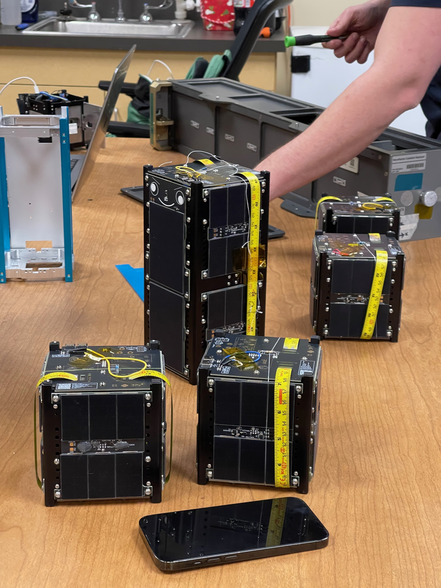

# PROVES Software

<div class="mt-4 text-xl">
Write flight software for real spacecraft with F´
</div>

<!--
- 20 minute presentation.
- The Discord bar and QR code stay up the whole time.
-->

---

# Who Am I?

<div class="grid grid-cols-2 gap-4">
  <div>
    <ul>
      <li><strong>Nate Gay</strong>, full time software engineer at <strong>WP Engine</strong></li>
      <li>Taking math classes for <strong>Formal Methods</strong></li>
      <li>BAs in <strong>Political Science</strong> and <strong>Spanish Literature</strong></li>
      <li>Written <strong>2 flight softwares</strong>
        <ul>
          <li><strong>Python</strong>: flying now with Harvard</li>
          <li><strong>F´</strong>: flying now with UC Santa Cruz, Columbia, Northeastern, Cal Poly Pomona and TXST</li>
        </ul>
      </li>
    </ul>
  </div>
  <div>
    
  </div>
</div>

<!--
- Keep this quick!
- Partner came for a doctorate; I take classes in the math program because I'm interested in Formal Methods. Talk to me afterwards if you want to know more.
- BAs in Political Science and Spanish Literature.
- Full time software engineer at WP Engine.
- Written two flight softwares: a Python one flying now with Harvard, and an F Prime one flying now with UC Santa Cruz, Columbia, Northeastern, Cal Poly Pomona and TXST.
-->

---

# F´ (F Prime)

<div class="grid grid-cols-2 gap-4">
  <div>
    <ul>
      <li>Open source flight software framework from <strong>NASA JPL</strong></li>
      <li>Flew on the <strong>Ingenuity</strong> Mars helicopter</li>
      <li>You model the system in <strong>FPP</strong>, write behavior in <strong>C++</strong></li>
      <li>The rest of this talk: the six ideas you need to read an F´ project</li>
    </ul>
  </div>
  <div>
    
  </div>
</div>

<!--
- Jump right into F Prime.
- FPP generates the C++ scaffolding; you fill in the handlers.
-->

---

# Input: Commands &amp; Parameters

<div class="grid grid-cols-2 gap-4">
  <div>
    <ul>
      <li><strong>Commands</strong>: the ground tells the spacecraft to <em>do</em> something</li>
      <li><strong>Parameters</strong>: settings the ground can change, persisted on board</li>
    </ul>
  </div>
  <div>

```text
@ Turn the heater on or off
async command SET_HEATER(on: bool)

@ Temperature that triggers a warning
param MAX_TEMP: F32 default 70.0
```

  </div>
</div>

<!--
- Commands are actions; parameters are configuration.
- Both come up from the ground station.
-->

---

# Output: Events &amp; Telemetry

<div class="grid grid-cols-2 gap-4">
  <div>
    <ul>
      <li><strong>Events</strong>: something happened (logs with a severity)</li>
      <li><strong>Telemetry</strong>: the current value of something, sampled over time</li>
    </ul>
  </div>
  <div>

```text
event OverTemp(temp: F32) \
  severity warning high \
  format "Over temperature: {} C"

telemetry Temperature: F32
```

  </div>
</div>

<!--
- Events answer "what happened?"
- Telemetry answers "what is it right now?"
-->

---

# Components

<div class="grid grid-cols-2 gap-4">
  <div>
    <ul>
      <li>One component per discrete service: <strong>ADCS</strong>, <strong>thermal</strong>, <strong>radio</strong>, <strong>power</strong></li>
      <li>Owns its commands, parameters, events and telemetry</li>
      <li>Never calls another component directly</li>
    </ul>
  </div>
  <div>

```text
module Pico {
  active component Thermal {
    async command SET_HEATER(on: bool)
    param MAX_TEMP: F32 default 70.0
    event OverTemp(temp: F32) ...
    telemetry Temperature: F32

    sync input port run: Svc.Sched
  }
}
```

  </div>
</div>

<!--
- Components are how we segment the software.
- Each one can be built and tested on its own.
-->

---

# Ports

<div class="grid grid-cols-2 gap-4">
  <div>
    <ul>
      <li>Typed <strong>inputs</strong> and <strong>outputs</strong> of a component</li>
      <li>The only way components talk to each other</li>
      <li><strong>sync</strong>: runs on the caller's thread · <strong>async</strong>: queued</li>
    </ul>
  </div>
  <div>

```text
port TempRead(celsius: F32)

active component Thermal {
  output port heaterOn: Fw.Logic
  sync input port run: Svc.Sched
  async input port tempIn: TempRead
}
```

  </div>
</div>

<!--
- Ports define a component's contract.
- Because components only see ports, you can swap a real sensor for a simulated one.
-->

---

# Topologies

<div class="grid grid-cols-2 gap-4">
  <div>
    <ul>
      <li>Declare which <strong>instances</strong> exist</li>
      <li>Wire <strong>output ports</strong> to <strong>input ports</strong></li>
      <li>The whole spacecraft on one page</li>
    </ul>
  </div>
  <div>

```text
topology Pico {
  instance tempSensor
  instance thermal
  instance heater

  connections Thermal {
    tempSensor.reading -> thermal.tempIn
    thermal.heaterOn -> heater.set
  }
}
```

  </div>
</div>

<!--
- Topologies define which components talk to which other components.
-->

---

# Rate Groups

<div class="grid grid-cols-2 gap-4">
  <div>
    <ul>
      <li>The spacecraft's <strong>main loop</strong></li>
      <li>A timer ticks the rate group driver</li>
      <li>Each rate group calls its members' <code>run</code> port in order</li>
      <li>e.g. 10 Hz for ADCS, 1 Hz for thermal</li>
    </ul>
  </div>
  <div>

```text
connections RateGroups {
  rateGroupDriver.CycleOut[0] -> rateGroup1Hz.CycleIn
  rateGroup1Hz.RateGroupMemberOut[0] -> thermal.run
  rateGroup1Hz.RateGroupMemberOut[1] -> telemSend.run
}
```

  </div>
</div>

<!--
- Rate groups define the main loop.
- Fast loops for things that need it, slow loops for everything else.
-->

---
layout: center
class: text-center
---

# Demo: Pico Thermal in the GDS

<div class="mt-4 text-xl">
Commands up · Events &amp; telemetry down
</div>

<!--
- Switch to the F Prime GDS running the pico thermal demo.
- Send a command, change a parameter, watch events and telemetry come back.
-->

---

# Where to Go Next

<ul>
  <li><strong>Software Meeting</strong>: Thursdays at 9pm on Discord (scan the QR code)</li>
  <li><strong>F´ tutorials</strong>: <a href="https://fprime.jpl.nasa.gov/latest/tutorials/">fprime.jpl.nasa.gov/latest/tutorials</a></li>
  <li><strong>PROVES flight software</strong>: <a href="https://github.com/Open-Source-Space-Foundation/proves-core-reference">github.com/Open-Source-Space-Foundation/proves-core-reference</a></li>
</ul>

<!--
- Come to the software meeting.
- Work through the F Prime tutorials before you show up if you can.
-->

---
layout: center
class: text-center
---

# 7 Minutes of Terror

<Youtube id="Ki_Af_o9Q9s" width="720" height="405" />

<!--
- Play the video to get folks hyped.
-->
