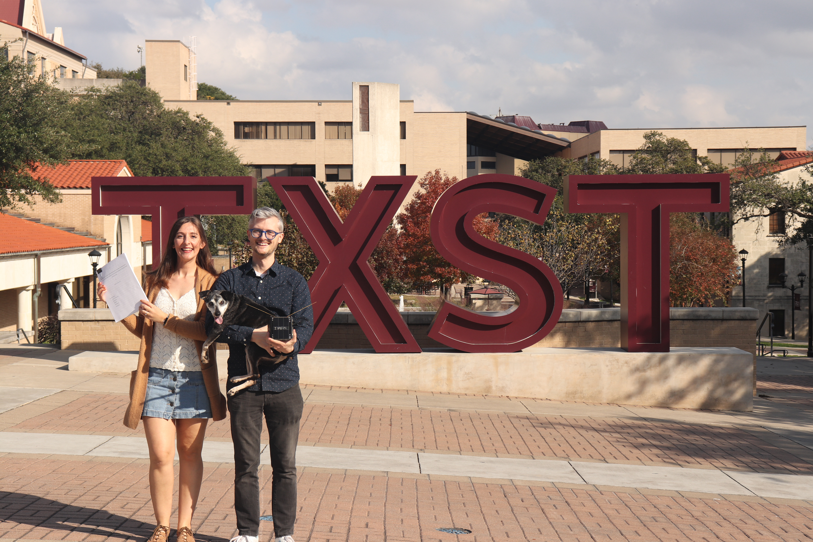
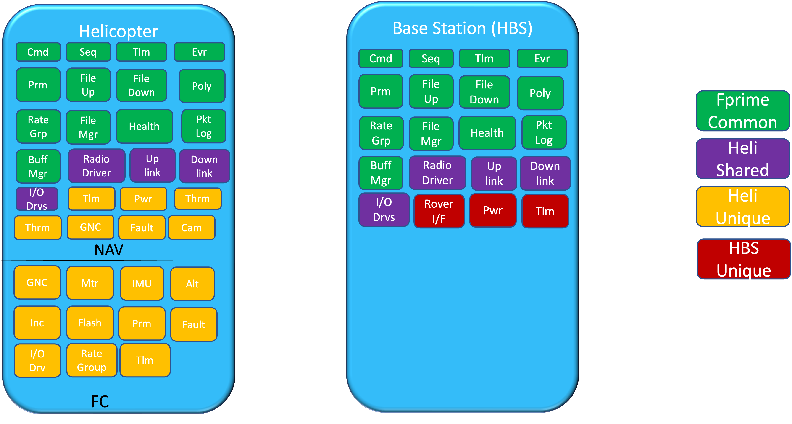
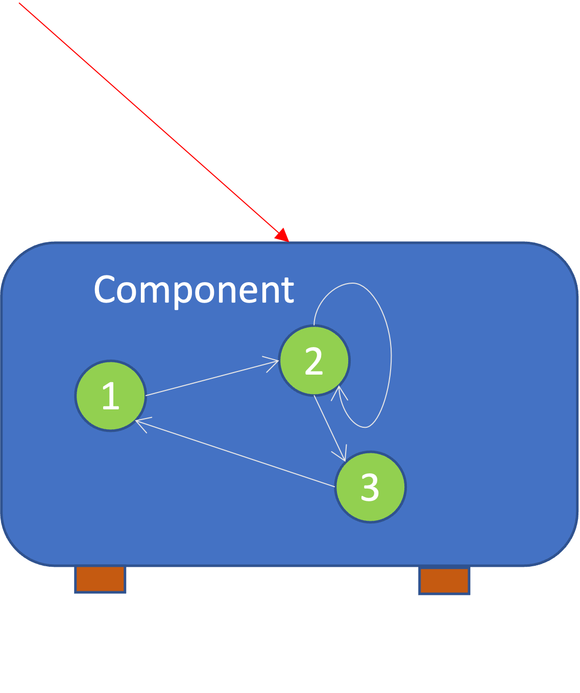
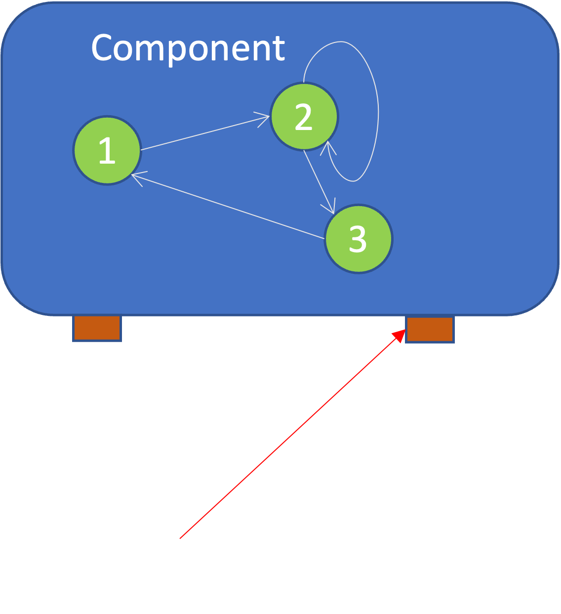
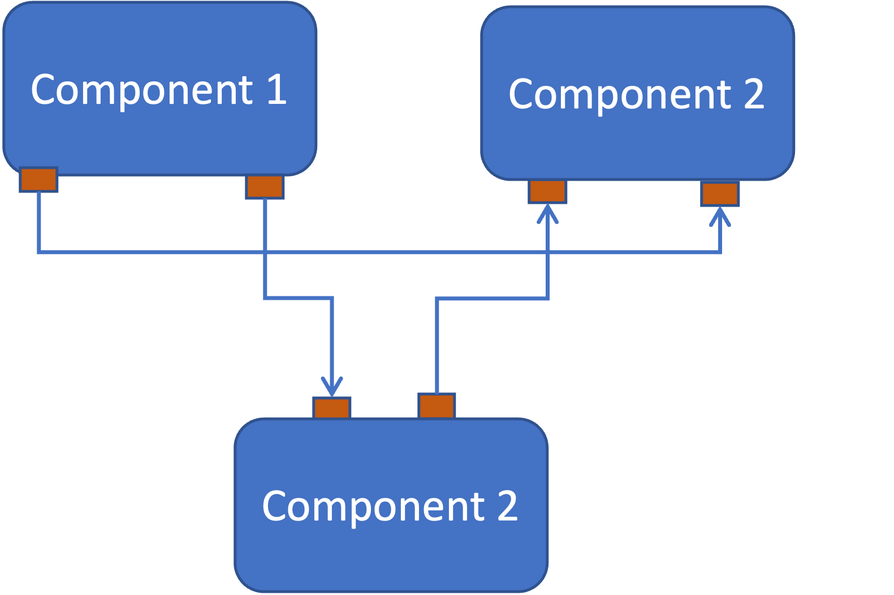
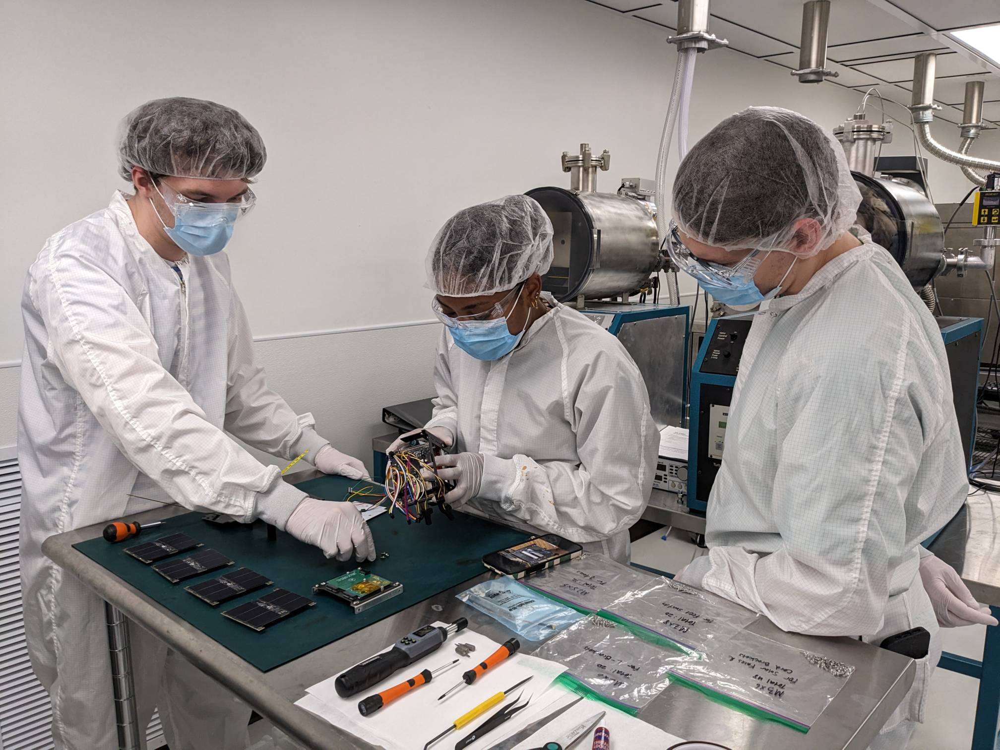

# PROVES Software

<div class="mt-4 text-xl">
Write flight software for real spacecraft with F´
</div>

<!--
- 20 minute presentation.
- The Discord bar and QR code stay up the whole time.
-->

---

# Agenda

<div class="grid grid-cols-2 gap-8 text-lg">
  <ol>
    <li>Who am I?</li>
    <li>Our software is in space</li>
    <li>F´ and the FPP modeling language</li>
    <li>Input: commands &amp; parameters</li>
    <li>Output: events &amp; telemetry</li>
  </ol>
  <ol start="6">
    <li>Components, ports &amp; topologies</li>
    <li>Rate groups</li>
    <li>Demo: pico thermal in the GDS</li>
    <li>Where to go next</li>
  </ol>
</div>

<!--
- Quick roadmap of the next 20 minutes.
-->

---

# Who Am I?

<div class="grid grid-cols-2 gap-4">
  <div>
    <ul>
      <li><strong>Nate Gay</strong>, full time software engineer at <strong>WP Engine</strong></li>
      <li>Taking math classes for <strong>Formal Methods</strong></li>
      <li>BAs in <strong>Political Science</strong> and <strong>Spanish Literature</strong></li>
      <li>Written <strong>2 flight softwares</strong>
        <ul>
          <li><strong>Python</strong>: flying now with Harvard</li>
          <li><strong>F´</strong>: flying now with UC Santa Cruz, Columbia, Northeastern, Cal Poly Pomona and TXST</li>
        </ul>
      </li>
    </ul>
  </div>
  <div>
    
  </div>
</div>

<!--
- Keep this quick!
- Partner came for a doctorate; I take classes in the math program because I'm interested in Formal Methods. Talk to me afterwards if you want to know more.
- BAs in Political Science and Spanish Literature.
- Full time software engineer at WP Engine.
- Written two flight softwares: a Python one flying now with Harvard, and an F Prime one flying now with UC Santa Cruz, Columbia, Northeastern, Cal Poly Pomona and TXST.
-->

---

# Our Software Is in Space

<div class="grid grid-cols-2 gap-4">
  <div>
    <ul>
      <li><strong>PROVES Five</strong>: 4 satellites deployed from the ISS on <strong>July 2, 2026</strong>, running F´ flight software written at TXST</li>
      <li>Operated by <strong>Columbia</strong>, <strong>UC Santa Cruz</strong>, <strong>Northeastern</strong> and <strong>Harvard</strong>; platform by Cal Poly Pomona's <strong>Bronco Space</strong></li>
      <li><strong>PROVES-Maia</strong>: TXST's first satellite, launched <strong>October 13, 2026</strong> on a Falcon 9 (CRS-35)</li>
    </ul>
    <div class="mt-4 text-sm">
      <a href="https://news.txst.edu/research-and-innovation/2026/txst-developed-flight-software-satellites.html">TXST-developed flight software powers satellites deployed from the ISS</a><br>
      <a href="https://news.txst.edu/research-and-innovation/2026/txst-launches-first-satellite-into-space.html">TXST's first-ever satellite launches into space</a>
    </div>
  </div>
  <div>
    
    <p class="mt-1 text-xs opacity-60">Photo: NASA/John Kraus</p>
  </div>
</div>

<!--
- PROVES Five satellites launched to the ISS on CRS-35 on April 11 and deployed July 2.
- Within days of deployment we made contact with two spacecraft and sent our first confirmed command.
- Maia carries MOSAIC and a TXST-designed radiation sensor. Students will command it from the ground station in San Marcos.
-->

---

# F´ (F Prime)

<div class="grid grid-cols-2 gap-4">
  <div>
    <ul>
      <li>Open source flight software framework from <strong>NASA JPL</strong></li>
      <li>Flew on the <strong>Ingenuity</strong> Mars helicopter</li>
      <li>You model the system in <strong>FPP</strong>, write behavior in <strong>C++</strong></li>
      <li>The rest of this talk: the ideas you need to read an F´ project</li>
    </ul>
  </div>
  <div>
    
    <p class="mt-1 text-xs opacity-60">Ingenuity's F´ deployments. Source: <a href="https://fprime.jpl.nasa.gov/overview/powerful-swa/">fprime.jpl.nasa.gov</a></p>
  </div>
</div>

<!--
- Jump right into F Prime.
- FPP generates the C++ scaffolding; you fill in the handlers.
-->

---

# FPP: The F´ Modeling Language

<div class="grid grid-cols-[2fr_3fr] gap-4">
  <div>
    <ul>
      <li>You <strong>describe</strong> the system in <code>.fpp</code> files: components, ports, commands, telemetry, topologies</li>
      <li>The build turns FPP into C++ <strong>autocode</strong>: <code>*Ac.hpp</code> / <code>*Ac.cpp</code> base classes</li>
      <li>Autocode handles queues, threads, serialization and port wiring. <strong>Never edit it</strong></li>
      <li>You subclass the base class and write only the <strong>handlers</strong></li>
      <li>FPP also generates the <strong>dictionary</strong> the GDS uses to decode telemetry</li>
    </ul>
  </div>
  <div>

```text
PicoTempManager.fpp
  ▼ fpp
PicoTempManagerComponentAc.cpp   (generated)
  ▲ inherits
PicoTempManager.cpp              (you write)
```

```cpp
void PicoTempManager::GetPicoTemperature_cmdHandler(
    FwOpcodeType opCode, U32 cmdSeq) {
  F64 temperature = this->getPicoTemperature();
  this->log_ACTIVITY_HI_PicoTemperature(temperature);
  this->cmdResponse_out(opCode, cmdSeq,
                        Fw::CmdResponse::OK);
}
```

<p class="mt-1 text-xs opacity-60">Simplified from: <a href="https://github.com/Open-Source-Space-Foundation/proves-core-reference/blob/main/PROVESFlightControllerReference/Components/Drv/PicoTempManager/PicoTempManager.cpp">PicoTempManager.cpp</a></p>

  </div>
</div>

<!--
- FPP is a modeling language, not a programming language: it declares structure.
- fprime-util generate / build runs the FPP tools; the generated files end in "Ac" for autocode.
- fprime-util impl stubs out the handler files for you to fill in.
- Every command, port and event you declare becomes a method you implement or call.
-->

---

# Input: Commands &amp; Parameters

<div class="grid grid-cols-[2fr_3fr] gap-4">
  <div>
    <ul>
      <li><strong>Commands</strong>: the ground tells the spacecraft to <em>do</em> something</li>
      <li><strong>Parameters</strong>: settings the ground can change, persisted on board</li>
    </ul>
  </div>
  <div>

```text
# PicoTempManager.fpp
sync command GetPicoTemperature()

# ThermalManager.fpp
param FACE_TEMP_LOWER_THRESHOLD: F64 default -40.0
param FACE_TEMP_UPPER_THRESHOLD: F64 default 60.0
```

<p class="mt-1 text-xs opacity-60">Simplified from: <a href="https://github.com/Open-Source-Space-Foundation/proves-core-reference/blob/main/PROVESFlightControllerReference/Components/ThermalManager/ThermalManager.fpp">ThermalManager.fpp</a> · <a href="https://github.com/Open-Source-Space-Foundation/proves-core-reference/blob/main/PROVESFlightControllerReference/Components/Drv/PicoTempManager/PicoTempManager.fpp">PicoTempManager.fpp</a></p>

  </div>
</div>

<!--
- Commands are actions; parameters are configuration.
- Both come up from the ground station.
- GetPicoTemperature reads the RP2350's built-in die temperature on demand.
- The thermal thresholds can be retuned from the ground without reflashing.
-->

---

# Output: Events &amp; Telemetry

<div class="grid grid-cols-[2fr_3fr] gap-4">
  <div>
    <ul>
      <li><strong>Events</strong>: something happened (logs with a severity)</li>
      <li><strong>Telemetry</strong>: the current value of something, sampled over time</li>
    </ul>
  </div>
  <div>

```text
# ThermalManager.fpp
event TemperatureAboveThreshold(sensorId: U32, temp: F64) \
  severity warning low \
  format "Sensor {} at {} °C"

# PicoTempManager.fpp
telemetry PicoTemperature: F64
```

<p class="mt-1 text-xs opacity-60">Simplified from: <a href="https://github.com/Open-Source-Space-Foundation/proves-core-reference/blob/main/PROVESFlightControllerReference/Components/ThermalManager/ThermalManager.fpp">ThermalManager.fpp</a> · <a href="https://github.com/Open-Source-Space-Foundation/proves-core-reference/blob/main/PROVESFlightControllerReference/Components/Drv/PicoTempManager/PicoTempManager.fpp">PicoTempManager.fpp</a></p>

  </div>
</div>

<!--
- Events answer "what happened?"
- Telemetry answers "what is it right now?"
- ThermalManager fires an event when a face or battery sensor crosses a threshold.
- PicoTempManager writes the Pico's temperature to telemetry every time it's read.
-->

---

# Components

<div class="grid grid-cols-[2fr_3fr] gap-4">
  <div>
    <ul>
      <li>One component per discrete service: <strong>ADCS</strong>, <strong>thermal</strong>, <strong>radio</strong>, <strong>power</strong></li>
      <li>Owns its commands, parameters, events and telemetry</li>
      <li>Never calls another component directly</li>
    </ul>
    
  </div>
  <div>

```text
passive component PicoTempManager {
  sync input port picoTemperatureGet: picoTemperatureGet

  sync command GetPicoTemperature()

  telemetry PicoTemperature: F64

  event PicoTemperature(temperature: F64) \
    severity activity high \
    format "Pico Temperature: {} °C"
}
```

<p class="mt-1 text-xs opacity-60">Simplified from: <a href="https://github.com/Open-Source-Space-Foundation/proves-core-reference/blob/main/PROVESFlightControllerReference/Components/Drv/PicoTempManager/PicoTempManager.fpp">PicoTempManager.fpp</a></p>

  </div>
</div>

<!--
- Components are how we segment the software.
- Each one can be built and tested on its own.
- PicoTempManager is a driver component: it owns one sensor and nothing else.
- Passive components have no thread; they run on whoever calls them.
-->

---

# Ports

<div class="grid grid-cols-[2fr_3fr] gap-4">
  <div>
    <ul>
      <li>Typed <strong>inputs</strong> and <strong>outputs</strong> of a component</li>
      <li>The only way components talk to each other</li>
      <li><strong>sync</strong>: runs on the caller's thread · <strong>async</strong>: queued</li>
    </ul>
    
  </div>
  <div>

```text
port picoTemperatureGet(ref condition: Fw.Success) -> F64

passive component ThermalManager {
  sync input port run: Svc.Sched
  output port faceTempGet: [5] Drv.temperatureGet
  output port picoTempGet: Drv.picoTemperatureGet
}
```

<p class="mt-1 text-xs opacity-60">Simplified from: <a href="https://github.com/Open-Source-Space-Foundation/proves-core-reference/blob/main/PROVESFlightControllerReference/Components/ThermalManager/ThermalManager.fpp">ThermalManager.fpp</a></p>

  </div>
</div>

<!--
- Ports define a component's contract.
- Because components only see ports, you can swap a real sensor for a simulated one.
- ThermalManager doesn't know what a TMP112 or the Pico is. It only knows it has ports that return a temperature.
- Port arrays: one output port per face / battery cell sensor.
-->

---

# Topologies

<div class="grid grid-cols-[2fr_3fr] gap-4">
  <div>
    <ul>
      <li>Declare which <strong>instances</strong> exist</li>
      <li>Wire <strong>output ports</strong> to <strong>input ports</strong></li>
      <li>The whole spacecraft on one page</li>
    </ul>
    
  </div>
  <div>

```text
instance thermalManager
instance picoTempManager

connections thermalManager {
  thermalManager.faceTempGet[0] -> tmp112Face0.temperatureGet
  thermalManager.picoTempGet -> picoTempManager.picoTemperatureGet
}
```

<p class="mt-1 text-xs opacity-60">Simplified from: <a href="https://github.com/Open-Source-Space-Foundation/proves-core-reference/blob/main/PROVESFlightControllerReference/ReferenceDeployment/Top/topology.fpp">topology.fpp</a></p>

  </div>
</div>

<!--
- Topologies define which components talk to which other components.
-->

---

# Rate Groups

<div class="grid grid-cols-[2fr_3fr] gap-4">
  <div>
    <ul>
      <li>The spacecraft's <strong>main loop</strong></li>
      <li>A timer ticks the rate group driver</li>
      <li>Each rate group calls its members' <code>run</code> port in order</li>
      <li>PROVES runs <strong>50 Hz</strong> (detumble), <strong>10 Hz</strong> (comms, sequencers) and <strong>1 Hz</strong> (thermal, power, ADCS)</li>
    </ul>
  </div>
  <div>

```text
connections RateGroups {
  timer.CycleOut -> rateGroupDriver.CycleIn

  rateGroupDriver.CycleOut[0] -> rateGroup50Hz.CycleIn
  rateGroup50Hz.RateGroupMemberOut[0] -> detumbleManager.run

  rateGroupDriver.CycleOut[2] -> rateGroup1Hz.CycleIn
  rateGroup1Hz.RateGroupMemberOut[0] -> thermalManager.run
}
```

<p class="mt-1 text-xs opacity-60">Simplified from: <a href="https://github.com/Open-Source-Space-Foundation/proves-core-reference/blob/main/PROVESFlightControllerReference/ReferenceDeployment/Top/topology.fpp">topology.fpp</a></p>

  </div>
</div>

<!--
- Rate groups define the main loop.
- Fast loops for things that need it, slow loops for everything else.
- Once a second, thermalManager.run polls every temperature sensor through its ports, including the Pico.
-->

---
layout: center
class: text-center
---

# Demo: Pico Thermal in the GDS

<div class="mt-4 text-xl">
Commands up · Events &amp; telemetry down
</div>

<!--
- Switch to the F Prime GDS running the pico thermal demo.
- Send a command, change a parameter, watch events and telemetry come back.
-->

---

# What We Covered

<div class="grid grid-cols-2 gap-8 text-lg">
  <ol>
    <li>Who am I?</li>
    <li>Our software is in space</li>
    <li>F´ and the FPP modeling language</li>
    <li>Input: commands &amp; parameters</li>
    <li>Output: events &amp; telemetry</li>
  </ol>
  <ol start="6">
    <li>Components, ports &amp; topologies</li>
    <li>Rate groups</li>
    <li>Demo: pico thermal in the GDS</li>
    <li>Where to go next</li>
  </ol>
</div>

<!--
- Recap before next steps. Everything here is linked on the next slide.
-->

---

# Where to Go Next

<div class="grid grid-cols-2 gap-6 text-sm">
  <div>
    <h3>Join us</h3>
    <ul>
      <li><strong>Software Meeting</strong>: Thursdays at 9pm on <a href="https://discord.gg/j9HCDdAe">Discord</a></li>
      <li><a href="https://github.com/Open-Source-Space-Foundation/proves-core-reference">PROVES flight software (proves-core-reference)</a></li>
    </ul>
    <h3 class="mt-4">Learn F´</h3>
    <ul>
      <li><a href="https://fprime.jpl.nasa.gov/latest/docs/tutorials/">F´ tutorials</a></li>
      <li><a href="https://nasa.github.io/fpp/fpp-users-guide.html">FPP user's guide</a></li>
      <li><a href="https://fprime.jpl.nasa.gov/overview/powerful-swa/">F´ architecture overview</a></li>
      <li><a href="https://fprime.jpl.nasa.gov/latest/docs/user-manual/overview/03-port-comp-top/">Ports, components &amp; topologies</a></li>
      <li><a href="https://fprime.jpl.nasa.gov/latest/docs/user-manual/overview/04-cmd-evt-chn-prm/">Commands, events, channels &amp; parameters</a></li>
    </ul>
  </div>
  <div>
    <h3>Read more</h3>
    <ul>
      <li><a href="https://news.txst.edu/research-and-innovation/2026/txst-developed-flight-software-satellites.html">TXST-developed flight software powers satellites deployed from the ISS</a></li>
      <li><a href="https://news.txst.edu/research-and-innovation/2026/txst-launches-first-satellite-into-space.html">TXST's first-ever satellite launches into space</a></li>
      <li><a href="https://www.youtube.com/watch?v=Ki_Af_o9Q9s">7 Minutes of Terror (NASA JPL)</a></li>
    </ul>
    
  </div>
</div>

<!--
- Come to the software meeting.
- Work through the F Prime tutorials before you show up if you can.
- These slides are the handout: every link here is clickable.
-->

---
layout: center
class: text-center
---

# 7 Minutes of Terror

<Youtube id="Ki_Af_o9Q9s" width="720" height="405" />

<!--
- Play the video to get folks hyped.
-->
